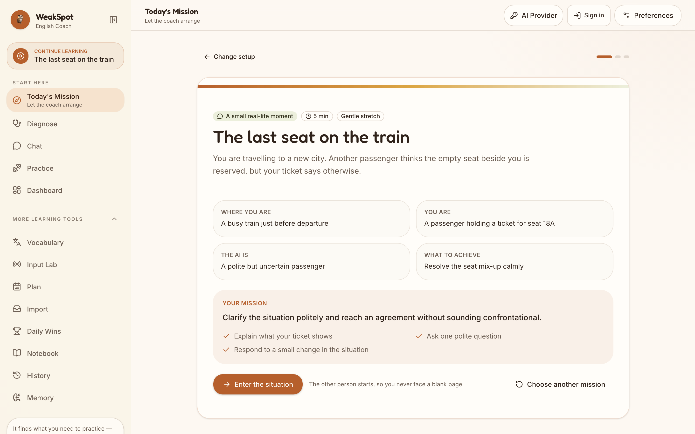
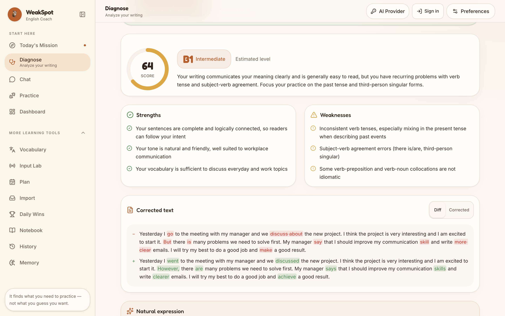
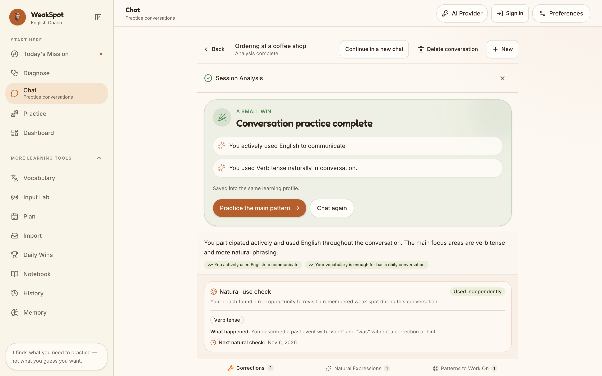
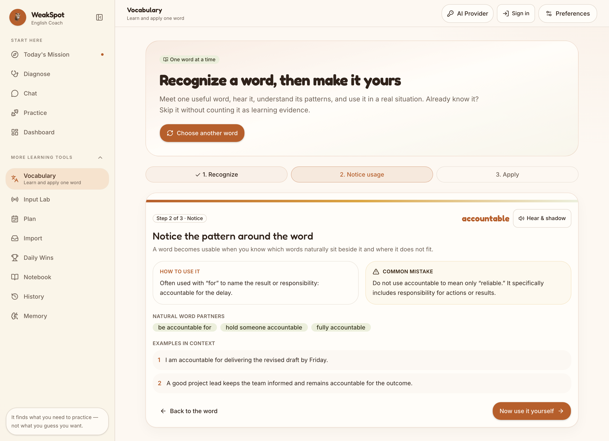
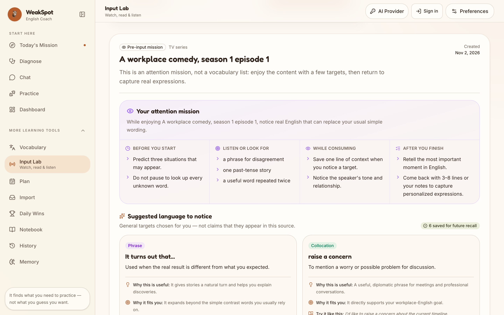
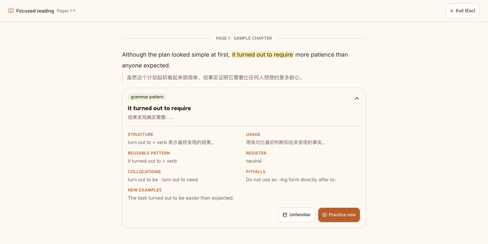
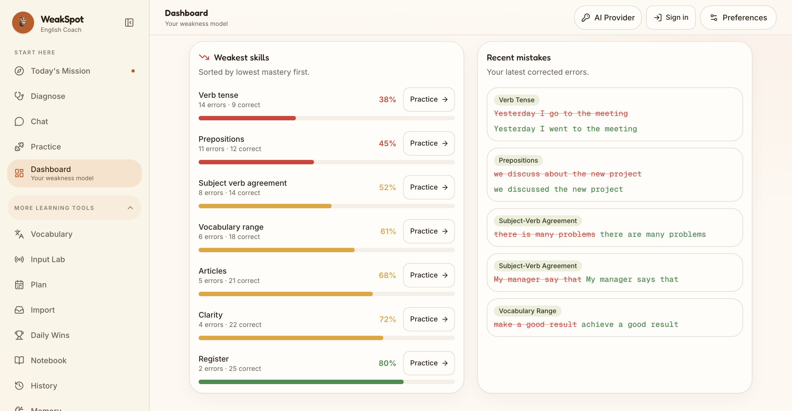
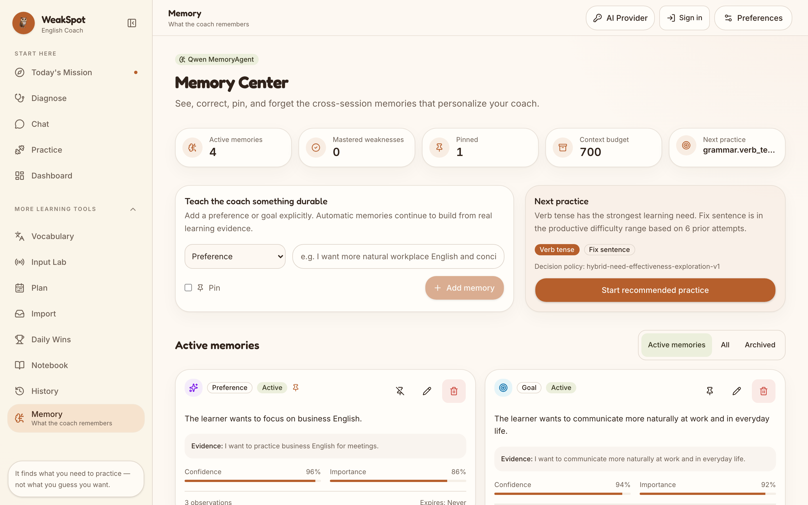
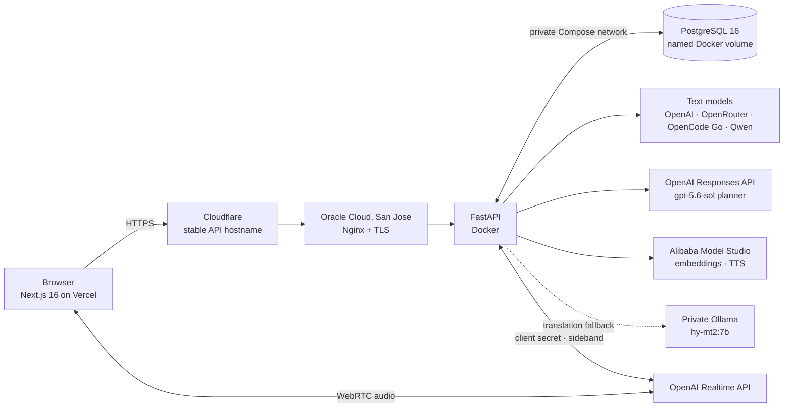

# WeakSpot English Coach

**An AI English coach that finds the patterns you keep getting wrong, remembers
them across sessions, and keeps creating real chances to practice them until
the evidence shows you have mastered them.**

**Live app:** [englearning.jinxxx.de](https://englearning.jinxxx.de) ·
**API health:** [enapi.jinxxx.de/api/v1/health](https://enapi.jinxxx.de/api/v1/health) ·
**License:** [MIT](LICENSE)

Try it as a guest or sign in with GitHub or Google. The interface and the
coach's explanations are available in English and Simplified Chinese.



*Screenshots in this README show the app running with its built-in demo data.*

## Contents

- [Why WeakSpot](#why-weakspot)
- [What you can do](#what-you-can-do)
- [How the coach learns](#how-the-coach-learns)
- [Under the hood](#under-the-hood)
- [Architecture](#architecture)
- [Tech stack](#tech-stack)
- [Getting started](#getting-started)
- [Tests and benchmark](#tests-and-benchmark)
- [Repository layout](#repository-layout)
- [Documentation](#documentation)
- [Project history](#project-history)

## Why WeakSpot

Most AI tutors correct the sentence in front of them, then forget you when the
session ends. WeakSpot keeps one learner model across every activity: writing
diagnosis, text and voice conversation, daily missions, vocabulary lessons,
real-world input, ebooks, imported ChatGPT history, and targeted exercises.
Every activity adds evidence to the same profile, and that profile decides
what you practice next.

The coach is deliberately careful about what it believes:

- **Grounded evidence only.** A weakness must quote words you actually wrote
  or said. The absence of an error is never counted as success.
- **Assisted is not independent.** If you opened a hint, or the coach modeled
  the wording first, the result is recorded as assisted.
- **No opportunity, no penalty.** If a task never gave you a fair chance to use
  a skill, nothing about that skill changes.
- **Mastery takes time.** A weakness counts as mastered only after spaced,
  varied, consistently successful practice, and it reopens if the mistake
  returns.
- **Production over recognition.** Activities ask you to write or speak:
  describe, retell, negotiate, explain. You never just pick an answer from a
  list.
- **Nothing hidden.** Every memory the coach keeps is visible, editable,
  pinnable, and forgettable in the Memory Center.

## What you can do

| Area | Page | What it does |
| --- | --- | --- |
| [Today's Mission](#todays-mission) | `/coach` | Choose time, response mode, and energy; the coach builds a realistic speaking or writing task |
| [Writing diagnosis](#writing-diagnosis) | `/` | Paste real writing for a CEFR estimate, corrections, micro-lessons, and next steps |
| [Conversation practice](#conversation-practice) | `/chat` | Roleplay by text or realtime voice, analyzed when you finish |
| [Vocabulary lessons](#vocabulary-lessons) | `/vocabulary` | Recognize one useful word, notice how it is used, then use it yourself |
| [Input Lab](#input-lab) | `/input` | Turn a show, podcast, article, or meeting into a few expressions you can reuse |
| [Private ebook library](#private-ebook-library) | `/input/ebooks` | Study your own EPUB or PDF with sentence-by-sentence help and annotations |
| [ChatGPT history import](#chatgpt-history-import) | `/import` | Find recurring mistakes in your past ChatGPT conversations |
| [Plan and practice](#plan-and-targeted-practice) | `/plan`, `/practice` | Follow a 7-day plan or drill one skill with adaptive exercises |
| [Progress and library](#progress-and-library) | `/dashboard`, `/stats`, `/notebook`, `/history` | Weakness model, streaks, saved notes, and every past submission |
| [Memory Center](#memory-center) | `/memory` | See and control everything the coach remembers about you |

### Today's Mission

*You do not need to know what to practice.* Make three choices: **time** (5,
10, or 15 minutes), **response mode** (type, or speak and then confirm the
transcript), and **energy** (light, balanced, or stretch). The coach picks a
focus from your learning profile and creates one of five production tasks, or
you can choose the format yourself:

| Format | What you do |
| --- | --- |
| **Live situation** | Reach a goal in a roleplay with an AI character who speaks first and stays in role. Each scene has a mild complication and rotates across 12 scenario families (service recovery, travel disruption, housing issues, tech support, and more), avoiding ones you used recently. |
| **Picture story** | Describe an app-owned illustration, separate what you see from what you infer, and tell a before–now–next story. |
| **Listen and retell** | Hear an original AI-voiced story with a limited number of replays, then retell the gist, infer intent, or apply it to a new situation. |
| **Make a decision** | Weigh two to four real-world constraints, choose, and explain your decision to a specific audience. |
| **Vocabulary in action** | Write a real message, such as an email, update, or request, that expresses given meanings precisely without a word list to copy. |

- The **briefing** shows the setting, both roles, the goal, and a visible
  checklist of what a good attempt will do. There are no hidden answers.
- **Progressive hints** (two to four levels) appear only when you ask. Opening
  any hint marks the attempt as *assisted*.
- **Feedback keeps two things apart:** whether you completed the task (your
  own checklist) and the quality of your English (analyzed only from what you
  produced).
- When the [GPT-5.6 Adaptive Mission Planner](#gpt-56-adaptive-mission-planner)
  is enabled, each briefing also explains *why this mission now*, *the evidence
  used*, *how the task adapted*, and *what the coach will observe*, and names
  the model that generated it.

### Writing diagnosis



Paste anything you have written, such as an email, a chat message, or an essay
paragraph, and choose **Quick** or **Deep** analysis. The report includes:

- an estimated **CEFR level** and an overall score, with strengths and
  weaknesses;
- the **corrected text** with a word-level diff, plus a freer **natural
  rewrite** when it makes the message substantially clearer;
- an **error breakdown** classified into 38 tracked skills, each error with its
  severity, an explanation, a micro-lesson, and a practice goal;
- **recommended next actions** and automatically created Notebook notes.

Every diagnosis updates your skill mastery and memory. Submitting identical
text again does not count the same evidence twice.

### Conversation practice



- Start a **free chat**, a classic scene (coffee shop, job interview, travel,
  restaurant, small talk), or a **generated situation**: Deep mode plans a
  15-minute roleplay with staged complications, and Fast creates a shorter
  scene. A briefing shows your role, the AI's role, and your goal first.
- Talk by **text** or **realtime voice** (OpenAI Realtime over WebRTC). If you
  stall mid-sentence in voice mode, the coach suggests ways to finish your
  thought.
- **Select any text** in the conversation to save it to your Notebook.
- **End & Analyze** to get corrections, more natural expressions, patterns to
  work on, next steps, and *Hear & shadow* audio for practicing rhythm and
  stress.
- The coach may quietly create a
  [natural-use check](#natural-use-checks-in-conversation): a fair chance to use
  one of your due weak spots. The analysis reports what happened afterwards.
- Voice transcripts are saved before analysis. If saving fails, the transcript
  survives a page refresh in the same tab and can be retried.

### Vocabulary lessons



Learn one useful word at a time in three steps:

1. **Recognize:** see the spelling, hear the word, and connect it to one clear
   meaning.
2. **Notice:** study natural collocations, examples in context, and a common
   mistake.
3. **Apply:** write a complete response to a realistic situation (audience,
   tone, and meanings to express) that uses the word naturally.

The coach checks meaning, grammar, collocation, and tone in that exact
sentence. Choosing "I already know this word" skips it without counting as
evidence, and one successful use is marked as needing confirmation in another
context.

### Input Lab



Bring something you actually encountered, such as a TV scene, film, video,
podcast, article, book, work document, or real conversation, and choose a mode:

- **Grounded capture:** paste a short excerpt or transcript. The coach picks a
  deliberately small set (3–12) of words, phrases, collocations, grammar
  patterns, pronunciation points, or cultural notes. Each item quotes the exact
  source text and explains why it is useful and why it fits you, based on your
  goals, weak spots, and what you have already seen.
- **Attention mission:** before you watch, read, or listen, get a
  before/during/after plan for what to notice and how to retell it, with no
  invented quotations.
- **Input to output:** retell the content, reuse the required expressions, and
  return later for a *delayed retrieval* check that counts as independent
  transfer.

Captured items are remembered for future practice and conversation. WeakSpot
never opens, downloads, or scrapes streaming services or publisher sites; you
paste only material you have the right to share.

### Private ebook library



Signed-in learners can turn their own English books into study material:

- **Import EPUB or text-based PDF** files with no upload size cap. Scanned PDFs
  are rejected because there is no OCR. EPUB chapters become stable pages of
  about 300 words, PDFs keep their page numbers, and the original upload is
  deleted after parsing.
- **Study 1–15 consecutive pages** at a time with a sentence-by-sentence
  counterpart (a Simplified Chinese translation or a plain-English version)
  and focused annotations that quote the source. Pages appear as soon as they
  finish, cancelling keeps completed pages, and reopening a book restores your
  last study pack.
- **Read in focus mode**, with the original, its counterpart, and annotations
  together.
- **Mark an unfamiliar item** to create a Notebook note, a provisional
  weakness, and a review target in one step.
- **Practice each target in three steps:** Understand, Guided use, and
  Independent transfer. An immediate independent success moves it to
  *learning*; a cold success in a new context at least 24 hours later marks it
  *mastered*.
- Deleting a book removes its text and the learning items linked to it; only
  anonymous aggregate skill totals remain.

### ChatGPT history import

Upload a ChatGPT data export (`.zip` or `conversations.json`) or paste a
`User:` / `Assistant:` transcript. WeakSpot ranks which conversations look like
English practice, lets you choose how many to analyze, and processes them in
batches of 20. It extracts four kinds of evidence (**your own errors,
expression gaps, corrections the AI already gave you, and its advice**) and adds
them to the same learning profile. If a later batch fails, completed batches
stay saved.

### Plan and targeted practice

- **7-day plan:** two 15-minute tasks per day with three exercises each (42 in
  total), getting harder across the week. It is built from your recent errors
  (past week or all time) plus your goals, preferences, strategies, and
  memories.
- **Practice:** choose a skill, or mixed practice, for a set of four exercises
  drawn from three types: *fix the sentence*, *fill in the blank*, and
  *rewrite*. The next skill and exercise format adapt to your actual results.
  Retrying after a network failure never grades the same answer twice.

### Progress and library



- **Dashboard:** estimated level, totals, your weakness model as a bar or radar
  chart, weakest skills, recent mistakes, and an evidence view (skills that are
  unassessed, being explored, or have enough evidence; assistance rate;
  delayed transfers). Skills you have never practiced are not shown as 50%.
- **Daily Wins:** a timezone-aware 7-day view of your streak, active days,
  focus minutes, average score, today's scorecard, achievement badges, and the
  next best action.
- **Notebook:** every expression, vocabulary, and grammar note plus your chat
  selections. Filter by *Current*, *Previous* (the related weakness has been
  resolved), or *All*, and export everything to Markdown.
- **History:** every submission and correction, with no display cap. Deleting
  an entry permanently removes it with its corrections and notes, and rolls its
  evidence back out of your weakness model.

### Memory Center



`/memory` shows everything the coach remembers about you (preferences, goals,
strategies, weaknesses, and experiences) with the evidence, confidence,
importance, expiry date, and verification status of each. You can:

- **add** a durable preference or goal (for example, "concise feedback and
  workplace English"), and **edit**, **pin**, or **forget** any memory;
- **test recall** to preview exactly what fits into the bounded context sent
  to the model, with a score breakdown;
- browse **recall traces**: an audit trail of what was recalled, why, and how
  many tokens it used;
- see the **next-practice decision** and the policy behind it;
- follow each weakness's **mastery evidence** and **adaptive retention**: next
  review, stability, relapse risk, practice stage, and mastery by mode
  (writing, text chat, voice, exercises).

### Settings and access

- **Language and appearance:** English or Simplified Chinese, light or dark
  mode, and four color palettes.
- **Model choice:** pick the server's Deep and Fast models independently, or
  bring your own OpenAI-compatible provider. A custom key stays in your
  browser, is sent only with each request, and is never stored on the server.
- **Access tiers:** guests get a small daily allowance per feature (3 by
  default), signed-in learners get more (20 by default), and owners and
  members are unlimited.
- **Owner tools:** an Admin page for managing owner and member access, and
  *Input Lab 2.0*, an experimental transcript-to-listening pilot. Both are
  protected by server-side owner checks.

## How the coach learns

### The learning loop

```text
you write, chat, speak, complete missions, learn words,
capture input, read ebooks, import history, or practice
   │
   ▼
structured analysis ── grounded errors, skill outcomes, memory candidates
   │
   ▼
memory lifecycle ───── merge evidence, replace conflicts, expire stale items
   │
   ▼
learner model ──────── skill mastery, per-mode evidence, retention schedule
   │
   ▼
bounded recall ─────── Memory Pack + next skill, exercise format, or mission
   │
   └──► the next activity is personalized, and you produce English again
```

### MemoryAgent

The MemoryAgent turns isolated sessions into a durable learner model. It keeps
five kinds of memory:

| Kind | Example | Default lifetime |
| --- | --- | --- |
| Preference | concise feedback, explanation language | no expiry |
| Goal | IELTS writing band, job-interview preparation | 365 days |
| Strategy | which exercise formats and conversation moves work for a skill | 180 days |
| Weakness | recurring article or verb-tense errors, with evidence | 60 days |
| Experience | a consequential recent practice result | 30 days |

- **Accumulates automatically.** Diagnosis, chat, and import analyses propose
  conservative memory candidates inside the same structured response, so no
  extra model call is needed. Practice results update strategy statistics.
- **Consolidates instead of duplicating.** Equivalent memories merge their
  evidence and observation counts. A conflicting statement under the same key
  replaces the old memory, which is kept as an audit record.
- **Tracks certainty.** Facts move from *candidate* to *observed* to
  *confirmed*. Candidates are down-weighted in retrieval, and the coach is told
  to confirm them naturally before relying on them.
- **Forgets on time.** Kind-specific expiry and recency decay, a cap of 200
  active memories that prunes low-value old experiences first,
  learner-controlled forgetting, and scheduled database cleanup.
- **Recalls within a fixed budget.** Hybrid ranking (50% semantic similarity
  from Qwen `text-embedding-v4`, 15% lexical match, 15% importance, 10%
  recency, 5% access frequency, 5% critical kind, and a 15% boost when pinned)
  fills a Memory Pack of at most six detailed memories under a 700-token
  ceiling, or 595 after a 15% safety reserve. Text chat sends only the latest
  12 messages, so prompts stay roughly the same size as history grows.
- **Explains itself.** Every recall writes a trace with the selected IDs,
  component scores, and token use. If embeddings are unavailable, retrieval
  falls back to lexical scoring.

### Evidence rules

The learner model records every skill outcome with one of five labels:

| Outcome | Meaning | Effect |
| --- | --- | --- |
| `success` | Used correctly without help | Strongest gain; a later transfer check is scheduled |
| `hinted_success` | Correct after a hint or modeled wording | Smaller gain; a nearer cold check is scheduled |
| `failure` | A fair chance, attempted, materially wrong | Weakness evidence; the review interval shortens |
| `avoided` | A fair chance, but the learner routed around the target | Stays due in a new context; not marked as a grammar error |
| `no_opportunity` | The skill was never fairly elicited | Nothing changes |

A weakness **graduates** to mastered only when all of these are true:

- at least 5 attempts on 3 or more days, spanning at least 14 days;
- at least 80% success in the latest 5 attempts, and an average of 85 or more
  across the latest 3;
- skill mastery of at least 85, with successes in at least two exercise
  formats;
- 14 days without the error recurring.

A new mistake later **reopens the same record** and logs the relapse. Each
weakness also carries a retention schedule (stability, difficulty, next due
check) and separate mastery for writing, text chat, voice, and exercises, so
success in one channel is not treated as proof of spontaneous use in another.
These thresholds are conservative product policy informed by research on
retrieval practice, spacing, and knowledge tracing; see the
[MemoryAgent design](docs/MEMORY_AGENT_DESIGN.md).

### Natural-use checks in conversation

During ordinary text chat, the coach can turn one *due* weakness into a natural
opportunity without announcing it, quoting your old mistake, or interrupting
the conversation:

- A check is considered only when your message contains meaningful,
  spontaneous English and the live topic genuinely fits the target (keyword
  and skill fit blended 55/45 with semantic similarity). Requests for
  translations, word meanings, or grammar explanations never get a check.
- The coach rotates four conversational moves (natural reformulation, meaning
  confirmation, genuine clarification, and content extension) and skips the
  check entirely when it would not sound natural.
- There are at most three confirmed opportunities per session. A target that
  found no fair opening is set aside for 12 hours.
- Targets progress from *replay* to *variation* to *transfer* only after
  independent cold success.
- When no weakness fits, the coach may neutrally *sample* an under-observed
  skill. A sample records coverage but can never lower your mastery or create
  a weakness on its own.

After the session, the analysis shows what happened, which move was used, and
when the next natural check is due.

### Choosing what to practice next

The next skill is ranked by **45% mastery gap + 25% recent error density + 20%
historical failure + 10% time since last practice**. The exercise format
balances learning need, closeness to a productive difficulty of about 75/100,
exploration of under-sampled formats, and the reliability of past results.
Every recommendation returns its component scores, the strategy memories
behind it, and a plain-language reason.

### GPT-5.6 Adaptive Mission Planner

Today's Mission and vocabulary lessons separate *selection* from
*generation*:

1. A deterministic scheduler decides what is due, weak, uncertain, relevant,
   and not over-practiced.
2. Only that bounded decision context (the selected skills plus a compact
   summary of goals, preferences, strategies, weaknesses, and recency) is sent
   to **`gpt-5.6-sol`** through the official **OpenAI Responses API** with
   `medium` reasoning.
3. Native **Pydantic Structured Outputs** return the mission and its
   `plannerInsight` (why now, evidence used, adaptation, evaluation focus) in a
   single response, and the UI shows both to the learner.

Requests use `store=false`, a hashed safety identifier, and server-only
credentials. If the planner is enabled without a key, or configured with a
model that is not GPT-5.6, requests fail instead of labeling another model's
output as GPT-5.6. When the planner is disabled, missions are generated by the
configured text models (Deep by default). `/api/v1/health` reports whether the
planner is enabled and configured without exposing secrets, and briefings it
generates show `gpt-5.6-sol · Responses API`.

The implementation lives in
[`openai_mission_service.py`](apps/api/app/services/openai_mission_service.py),
with the contract in [`coach.py`](apps/api/app/models/coach.py), routing in
[`coach_service.py`](apps/api/app/services/coach_service.py), and the evidence
panel in [`coach/page.tsx`](apps/web/app/coach/page.tsx).

## Under the hood

Beyond the features, much of the work went into making the learning record
trustworthy, model costs predictable, and learner data private.

### Reliability and data integrity

- **Safe retries.** Practice answers, chat turns, voice transcripts, input
  captures, and learning events carry stable client IDs. A lost response can
  be retried without re-grading, double-counting, or paying for a second model
  call.
- **Model first, then one transaction.** Model calls finish before any
  database transaction opens. The exact model output is saved as an immutable
  draft, then all of its effects (errors, notes, skills, memory, and the final
  result) commit together or not at all.
- **Concurrency control.** Row locks serialize learning-state, plan, and chat
  updates. A learner-scoped memory write lease with stale-writer fencing keeps
  two analyses from overwriting each other's evidence.
- **Long work without long requests.** End-of-chat analysis runs as a
  background job that the UI polls, and ebook study packs stream completed
  pages and can be cancelled.
- **No silent caps.** History, Notebook, chat sessions, and input captures use
  cursor pagination, so a large archive is always fully reachable.
- **Traceable failures.** Every response carries an `X-Request-ID` that ties a
  browser error to the backend logs.

### AI model routing

The backend is provider-neutral. Each AI task goes to a **Deep** (quality) or
**Fast** (latency) slot, and the deployment decides which models fill them.
Learners can pick a pair from a server-published catalog that never exposes
keys or endpoints.

| Task | Route |
| --- | --- |
| Chat replies, practice grading, mission and vocabulary answer feedback | Fast (chat can opt into Deep per session) |
| Practice generation, 7-day plans, end-of-chat analysis, Input Lab analysis, generated scenes | Deep (scenes can opt into Fast) |
| Writing diagnosis, ChatGPT import | Learner's choice of Fast or Deep |
| Today's Mission and vocabulary lessons | `gpt-5.6-sol` through the Responses API when enabled |
| Ebook sentence counterparts | Official `gpt-5.6-luna`, then a private Hunyuan MT2 (`hy-mt2:7b`) fallback |
| Realtime voice | OpenAI Realtime (`gpt-realtime-mini`, with `gpt-realtime-2` selectable) |
| Listening audio and shadowing | Qwen3-TTS-Flash, with a browser speech fallback |
| Semantic memory retrieval | Qwen `text-embedding-v4`, with a lexical fallback |
| Scheduling, mastery math, stats, notes, history | Deterministic code, no LLM |

With OpenRouter configured, the default pair is GPT-5.6 Luna Pro (Deep) and
GPT-5.6 Luna (Fast). They are served by the official OpenAI API first, under a
shared daily token budget that resets at 05:00 America/Los_Angeles, and then by
the matching OpenRouter models. DeepSeek V4 Pro and Flash (through OpenCode
Go), Qwen 3.7 Max and Plus (through Alibaba Model Studio), and any
OpenAI-compatible endpoint are selectable alternatives. Every structured
response is validated with Pydantic and retried on failure. See
[Model routing](docs/MODEL_ROUTING.md) for reasoning levels and fallbacks.

### Privacy, safety, and honest boundaries

- Model, database, OAuth, and realtime secrets stay on the server. The browser
  receives only short-lived Realtime client secrets.
- Identity is resolved on the server from the session or guest cookie, so a
  client cannot read or change another learner's data by editing a `userId`.
- Custom-provider keys are request-scoped, HTTPS-only, and never written to
  the database.
- Learner text, pasted sources, and task context are passed to models as
  untrusted data, never as instructions.
- Nothing is scraped: the app never fetches video, subtitle, or book URLs, and
  ebook imports require a rights confirmation.
- The app does not claim abilities it lacks. Picture tasks use app-owned
  illustrations and grade only your English, dictated speech is never scored
  for pronunciation, and AI-generated voices are labeled.
- Owner-only experiments and admin routes are enforced on the server, not just
  hidden in the UI.

## Architecture



The frontend runs on Vercel. A stable Cloudflare hostname fronts an Oracle
Cloud server in San Jose, where Nginx terminates TLS for the FastAPI container.
PostgreSQL 16 runs beside the API on the private Docker Compose network with no
public port. Its data lives in a named volume, and a verified `pg_dump` runs
daily with seven days of archives. Alembic migrations run before each new API
container starts, and `/api/v1/health/ready` confirms database connectivity.

The schema is relational where the app needs identity, constraints, and
indexes (users and access roles, learning states and evidence events,
diagnoses, plans and practice attempts, memories and recall traces, input and
ebook data, chat sessions) and stores flexible model-produced detail in JSONB.
Earlier storage backends (Amazon DynamoDB, then Amazon RDS) are retired and
documented only as history. See
[Architecture](docs/ARCHITECTURE.md) for the request, transaction, and
concurrency design.

## Tech stack

| Layer | Technology |
| --- | --- |
| Frontend | Next.js 16 (App Router), React 19, TypeScript, Tailwind CSS 4, shadcn/ui on Base UI, Recharts, SWR, JSZip |
| Backend | Python 3.11, FastAPI, Pydantic v2, SQLAlchemy 2, psycopg 3, Alembic, OpenAI Python SDK, httpx, PyJWT, pypdf, uv |
| Database | PostgreSQL 16 with typed, indexed columns and JSONB payloads |
| Text AI | GPT-5.6 Luna Pro and Luna (official OpenAI and OpenRouter), DeepSeek V4 Pro and Flash (OpenCode Go), Qwen 3.7 Max and Plus (Model Studio), any OpenAI-compatible API |
| Mission planner | OpenAI Responses API, `gpt-5.6-sol`, Pydantic Structured Outputs |
| Voice and speech | OpenAI Realtime API over WebRTC, Qwen3-TTS-Flash, browser speech recognition and synthesis fallbacks |
| Retrieval | Qwen `text-embedding-v4` (256 dimensions) with hybrid lexical ranking |
| Auth | GitHub and Google OAuth, signed session cookies, guest cookies, per-tier daily limits |
| Infrastructure | Vercel, Cloudflare, Oracle Cloud with Docker Compose, Nginx, and TLS |

## Getting started

### Prerequisites

- Node.js 24 (see [`.nvmrc`](.nvmrc)) and pnpm 9 (`corepack enable`)
- Python 3.11 and [uv](https://docs.astral.sh/uv/)
- Docker, for PostgreSQL and the local API container

### Option 1: explore the UI with mock data

No backend is needed. Leave `NEXT_PUBLIC_API_BASE_URL` unset and the app uses
built-in mock data, including a populated Memory Center.

```bash
cd apps/web
pnpm install
pnpm dev        # if apps/web/.env.local sets the API URL: NEXT_PUBLIC_API_BASE_URL= pnpm dev
```

### Option 2: run the full stack without API keys

The local Compose file starts PostgreSQL 16 and the API with
`USE_FAKE_AI=true`, which returns canned structured results instead of calling
a model. The main learning flows work end to end without any provider key.

```bash
cd apps/api
docker compose -f docker-compose.local.yml up -d --build

cd ../web
pnpm install
NEXT_PUBLIC_API_BASE_URL=/backend pnpm dev
```

Open <http://localhost:3000>. Next.js proxies `/backend` to the API on
`127.0.0.1:8000`, whose interactive docs are at <http://localhost:8000/docs>.

### Option 3: connect real AI providers

```bash
cd apps/api
docker compose -f docker-compose.local.yml stop api   # free port 8000 if Option 2 is running
docker compose -f docker-compose.local.yml up -d postgres
uv sync
cp .env.example .env                                  # then add the keys you need
uv run alembic upgrade head
uv run uvicorn app.main:app --reload --port 8000
```

Start the frontend as in Option 2. Configure only what you need in
`apps/api/.env`, and never commit that file:

| To enable | Set |
| --- | --- |
| Text AI | At least one of `OPENROUTER_API_KEY`, `OPENCODE_GO_API_KEY`, `QWEN_MODEL_STUDIO_API_KEY`, or `OPENAI_COMPAT_API_KEY` with `OPENAI_COMPAT_BASE_URL` and `OPENAI_COMPAT_MODEL` |
| Official-first Luna routing, ebook translation, realtime voice | `OPENAI_API_KEY` |
| GPT-5.6 Adaptive Mission Planner | `OPENAI_BUILD_WEEK_ENABLED=true` (reuses `OPENAI_API_KEY`; the model is `gpt-5.6-sol`) |
| Semantic memory retrieval and AI speech | `QWEN_MODEL_STUDIO_API_KEY`, or `QWEN_EMBEDDING_API_KEY` and `QWEN_TTS_API_KEY` for separate accounts |
| Ebook translation fallback | `LOCAL_QWEN_BASE_URL` and `LOCAL_QWEN_MODEL` for a private Ollama server |
| Sign-in (required for the ebook library) | `SESSION_SECRET` plus `GITHUB_CLIENT_ID` and `GITHUB_CLIENT_SECRET`, or `GOOGLE_CLIENT_ID` and `GOOGLE_CLIENT_SECRET` |

[`.env.example`](apps/api/.env.example) documents every option, including the
legacy `DEEPSEEK_*` profile. For production, see the
[backend deployment guide](apps/api/DEPLOY.md); the frontend deploys from
`apps/web` on Vercel with `NEXT_PUBLIC_API_BASE_URL` set to the API's HTTPS
origin.

## Tests and benchmark

Backend checks run offline or against the local PostgreSQL container with fake
AI. They need no cloud account and no model key.

```bash
cd apps/api
docker compose -f docker-compose.local.yml up -d postgres
uv run python -m scripts.smoke_test            # imports, schemas, routing contracts
uv run python -m scripts.integration_test      # full learner loop against PostgreSQL + fake AI
uv run python -m scripts.memory_agent_test     # memory lifecycle, graduation, relapse, decisions
uv run python -m scripts.stealth_input_test    # natural-use checks, transcripts, Input Learning
uv run python -m scripts.coach_contract_test   # Today's Mission, GPT-5.6 planner, speech contracts
uv run python -m scripts.ebook_test            # private import, grounding, review, cleanup
uv run python -m scripts.memory_benchmark      # recall, stale suppression, context budget
```

More focused contract tests (deduplication, diagnosis claims, plan lifecycle,
quota routing, storage, and migration) live in
[`apps/api/scripts/`](apps/api/scripts), and [Local Testing](LOCAL_TESTING.md)
describes every tier.

```bash
cd apps/web
pnpm lint
pnpm exec tsc --noEmit
pnpm test:chat-import           # ChatGPT import batching limits
pnpm test:timeouts              # request deadlines for long model calls
pnpm test:realtime-transcript   # voice transcript handling
pnpm build
```

The secret-free MemoryAgent benchmark currently reports Recall@6 of `0.80` (4
of 5 fixtures), full suppression of expired and superseded memories, full
token-budget compliance, and an `87.3%` context reduction (1,444 estimated
tokens of raw history versus a 183.8-token average Memory Pack). It is a small
regression floor, not a production-quality claim; the
[MemoryAgent design](docs/MEMORY_AGENT_DESIGN.md) explains the missed fixture
and how to run the live-embedding variant.

## Repository layout

```text
apps/
  api/                 FastAPI backend
    app/api/routes/    HTTP routes: diagnose, chat, realtime, coach, memory, ebooks, ...
    app/services/      AI calls, MemoryAgent, scheduling, grading, session analysis
    app/core/          skill taxonomy and mastery math
    app/db/            PostgreSQL schema and repositories
    app/models/        Pydantic request, response, and model-output contracts
    alembic/           database migrations
    scripts/           offline tests, benchmark, and operations tools
    deploy/            production env template, Nginx example, startup and backup scripts
  web/                 Next.js frontend
    app/               one folder per page: coach, chat, memory, input/ebooks, ...
    components/        UI components built on shadcn/ui
    lib/               API client, English/Chinese copy, import parsing, helpers
    hooks/             realtime voice hook
docs/                  architecture, design notes, guides, runbooks, README screenshots
```

## Documentation

| If you want to… | Read |
| --- | --- |
| Learn Python, FastAPI, and Next.js through this codebase | [development.md](development.md) (中文) · [development.en.md](development.en.md) |
| Follow the source function by function | [Code walkthrough](docs/PROJECT_CODE_WALKTHROUGH_ZH.md) (中文) |
| Understand the production architecture | [Architecture](docs/ARCHITECTURE.md) |
| Dig into memory, evidence, and scheduling | [MemoryAgent design](docs/MEMORY_AGENT_DESIGN.md) |
| See which model handles which task | [Model routing](docs/MODEL_ROUTING.md) |
| Read the Today's Mission design and its boundaries | [Coach Mode P0](docs/COACH_MODE_P0.md) (中文) |
| Read the research behind guided learning | [Guided learning evidence](docs/product-strategy/GUIDED_LEARNING_EVIDENCE.md) |
| Test changes locally | [Local testing](LOCAL_TESTING.md) |
| Work with the database | [PostgreSQL beginner guide](docs/POSTGRESQL_BEGINNER_GUIDE.md) |
| Deploy or operate production | [Backend deployment](apps/api/DEPLOY.md) |
| Look up backend or frontend specifics | [apps/api/README.md](apps/api/README.md) · [apps/web/README.md](apps/web/README.md) |

The DynamoDB chapters in the development guides are historical; the
PostgreSQL beginner guide covers the current database.

## Project history

WeakSpot started on 2026-06-17 as a Next.js prototype generated with v0 and
grew through about 150 merged pull requests into the product described above.

| Date | Milestone |
| --- | --- |
| 2026-06-17 | First prototype generated with v0 |
| 2026-06-22 | Text chat and realtime voice practice ([#16](https://github.com/jinyu-cai/weakspot-english-coach/pull/16)) |
| 2026-07-10 to 07-12 | MemoryAgent, server model selection, and evidence-based weakness graduation ([#31](https://github.com/jinyu-cai/weakspot-english-coach/pull/31)) |
| 2026-07-13 | Natural-use checks and Input Learning ([#32](https://github.com/jinyu-cai/weakspot-english-coach/pull/32)); Today's Mission ([#39](https://github.com/jinyu-cai/weakspot-english-coach/pull/39)) |
| 2026-07-20 | GPT-5.6 Adaptive Mission Planner ([#70](https://github.com/jinyu-cai/weakspot-english-coach/pull/70)) |
| 2026-08-13 | Private ebook learning loop ([#116](https://github.com/jinyu-cai/weakspot-english-coach/pull/116)) |
| 2026-08-19 | Learner storage migrated from DynamoDB to PostgreSQL ([#139](https://github.com/jinyu-cai/weakspot-english-coach/pull/139)) |
| 2026-08-25 | Daily-quota routing for official OpenAI models and a Hunyuan MT2 translation fallback ([#153](https://github.com/jinyu-cai/weakspot-english-coach/pull/153)) |

## License

Released under the [MIT License](LICENSE).
